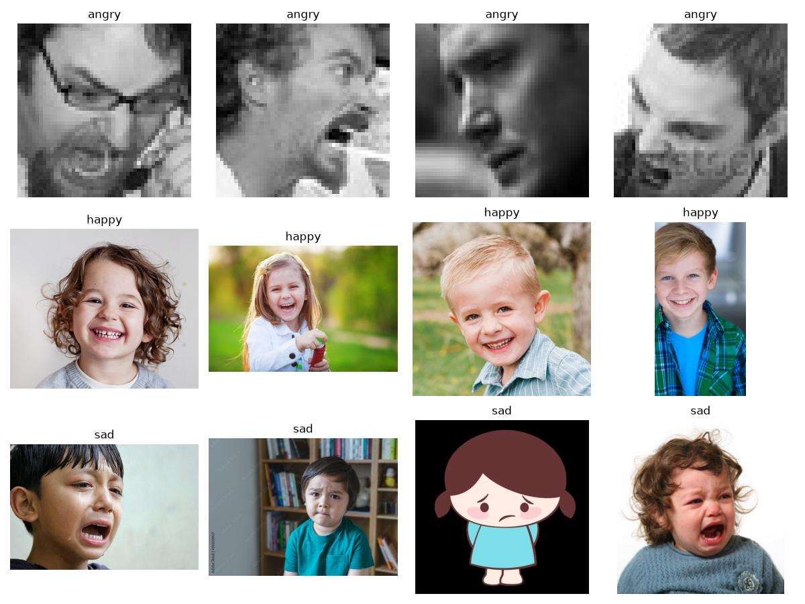
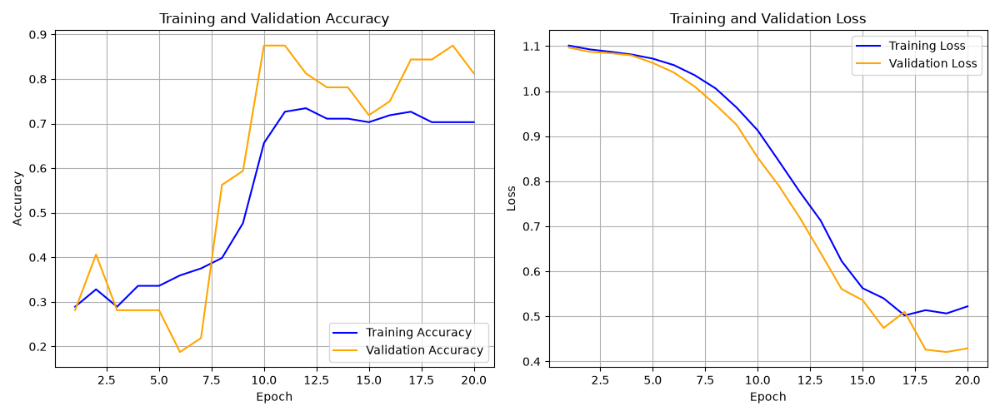

# Emotion Image Classifier (Angry / Happy / Sad)

A small image classifier built with TensorFlow/Keras that predicts the emotion shown in a picture: **angry**, **happy** or **sad**. The repository contains a from-scratch CNN pipeline, a MobileNetV2 transfer-learning script, and a single-image prediction script, all trained on a small hand-collected dataset of 210 images.



## Features

- Safe image validation (reports invalid files; deletion requires an explicit flag)
- Contact sheet of sample images from each class (`dataset_contact_sheet.jpg`)
- 70 / 20 / 10 train / validation / test split with a fixed seed
- Data augmentation (random horizontal flip and rotation)
- Training curves saved as `training_performance.png`
- Per-class precision, recall and F1 on the test set
- TensorBoard logging
- Command-line prediction for a single image (`predict.py`)

## Project structure

```
emotion-image-classifier/
├── image_classifier.py        # 3-class custom CNN: train, evaluate, save model
├── main.py                    # MobileNetV2 transfer-learning script
├── predict.py                 # predict the emotion of a single image
├── gradcam.py                 # Grad-CAM explanation for the custom CNN
├── requirements.txt
├── dataset_contact_sheet.jpg  # sample images per class (generated)
├── training_performance.png   # loss/accuracy curves (generated)
├── images/
│   ├── angry/                 # 70 images
│   ├── happy/                 # 71 images
│   └── sad/                   # 69 images
├── models/                    # saved model (created on first run)
└── logs/                      # TensorBoard logs (created on first run)
```

## Setup

Tested with Python 3.10 and TensorFlow 2.18 on Windows (CPU only).

```bash
git clone https://github.com/Harshh00100/emotion-image-classifier.git
cd emotion-image-classifier

python -m venv venv
venv\Scripts\activate        # Windows
# source venv/bin/activate   # macOS / Linux

pip install -r requirements.txt
```

Image validation uses Pillow rather than the removed `imghdr` standard-library module, so Python 3.13 is not blocked by that import.

## Dataset

Images live in one folder per class. Class indices follow alphabetical folder order: `angry = 0`, `happy = 1`, `sad = 2`.

```
images/
├── angry/   # 70 images
├── happy/   # 71 images
└── sad/     # 69 images
```

Both training scripts validate supported image files before training. By default, invalid files are reported and training stops without deleting anything. After reviewing the report, use `--delete-invalid` to explicitly remove invalid files with supported image extensions. Non-image files such as `.gitkeep` and unsupported extensions are ignored.

Notes about the data:

- The dataset is very small (210 images), so the model can overfit and the test set is only a few dozen images.
- The images in `angry/` are 48 x 48 pixels, while most `happy/` and `sad/` images are larger web photos. The model may partly learn image source or resolution instead of facial expression, so treat the results as a rough demo, not a benchmark.

## Usage

### 1. Train the custom CNN (`image_classifier.py`)

```bash
python image_classifier.py
```

The script will:

1. Validate images in `images/`; invalid files are reported without deletion by default
2. Save a sample grid to `dataset_contact_sheet.jpg`
3. Load images and split individual images 70 / 20 / 10 into train / validation / test
4. Train for up to 30 epochs (batch size 32, seed 42) with early stopping and TensorBoard logging
5. Save the loss/accuracy curves to `training_performance.png`
6. Print overall accuracy and per-class precision, recall and F1 on the test set
7. Save the model to `models/imageclassifier.keras`

View the training logs with:

```bash
tensorboard --logdir logs
```

### 2. Predict on a new image (`predict.py`)

Run after training with `image_classifier.py` so that `models/imageclassifier.keras` exists:

```bash
python predict.py path/to/image.jpg
```

Example output:

```
===================================
File:       path/to/image.jpg
Prediction: HAPPY (87.12%)
-----------------------------------
 - angry  :   5.30%
 - happy  :  87.12%
 - sad    :   7.58%
===================================
```

The class names are read from the dataset folders in alphabetical order. Pass `--model models/mobilenetv2_emotion.keras` to use the MobileNetV2 model trained by `main.py`.

### 3. Transfer learning with MobileNetV2 (`main.py`)

```bash
python main.py
```

This script validates the data, splits individual images 70 / 20 / 10, and trains a frozen MobileNetV2 backbone with flip/rotation augmentation, dropout, early stopping and best-model checkpointing. It uses a three-class softmax output and saves to `models/mobilenetv2_emotion.keras`.

## Model architecture

### Custom CNN (`image_classifier.py`)

| Layer | Details |
|---|---|
| Input | 256 x 256 x 3, scaled to [0, 1] |
| Augmentation | RandomFlip (horizontal), RandomRotation (0.1) |
| Conv2D + MaxPooling | 16 filters, 3x3, ReLU |
| Conv2D + MaxPooling | 32 filters, 3x3, ReLU |
| Conv2D + MaxPooling | 16 filters, 3x3, ReLU |
| GlobalAveragePooling2D | |
| Dense | 128 units, ReLU + Dropout (0.35) |
| Dense (output) | 3 units, softmax |

Loss: sparse categorical cross-entropy. Optimizer: Adam. Up to 30 epochs with early stopping.

### MobileNetV2 transfer learning (`main.py`)

| Layer | Details |
|---|---|
| Input | 256 x 256 x 3 (raw pixels, 0-255) |
| Augmentation | RandomFlip (horizontal), RandomRotation (0.1) |
| Preprocessing | `mobilenet_v2.preprocess_input` |
| Backbone | MobileNetV2, ImageNet weights, frozen |
| Head | GlobalAveragePooling2D, Dropout (0.4), Dense (3, softmax) |

Optimizer: Adam (learning rate 1e-4). Up to 30 epochs with early stopping on validation loss (patience 5).

## Results

Training curves from the custom CNN (`image_classifier.py`, 20 epochs):



By epoch 20, training accuracy is about 70% and validation accuracy about 80%, with the loss still decreasing, so the model has not fully converged. Exact test-set precision, recall and F1 are printed at the end of each run and are not stored in the repository.

Because the dataset is tiny and the split is coarse, these numbers are noisy and should be read as a sanity check, not a reliable benchmark.

## Explain a prediction with Grad-CAM

Train the custom CNN first, then create a heatmap for an input image:

```bash
python image_classifier.py
python gradcam.py path/to/face.jpg
```

The output is saved beside the input as `face_gradcam.png` (or specify `--output`). The heatmap highlights image regions that most influence the selected class score. It is an explanation aid, not proof that the model learned facial expression rather than dataset shortcuts. Grad-CAM currently supports the custom CNN model; use the default `models/imageclassifier.keras`.

## Known limitations

- The dataset contains only about 210 hand-collected images. Metrics are noisy and do not establish real-world accuracy.
- The current split is randomized per image, not stratified by class or grouped by person/source. Similar images or the same person could appear in multiple splits; use a larger, consistently sourced dataset and subject-aware splitting before drawing strong conclusions.
- Grad-CAM support currently targets the custom CNN. MobileNetV2 prediction and training are supported, but its nested backbone is not yet wired into the Grad-CAM graph.

## Tech stack

Python, TensorFlow / Keras, OpenCV, Pillow, NumPy, Matplotlib
